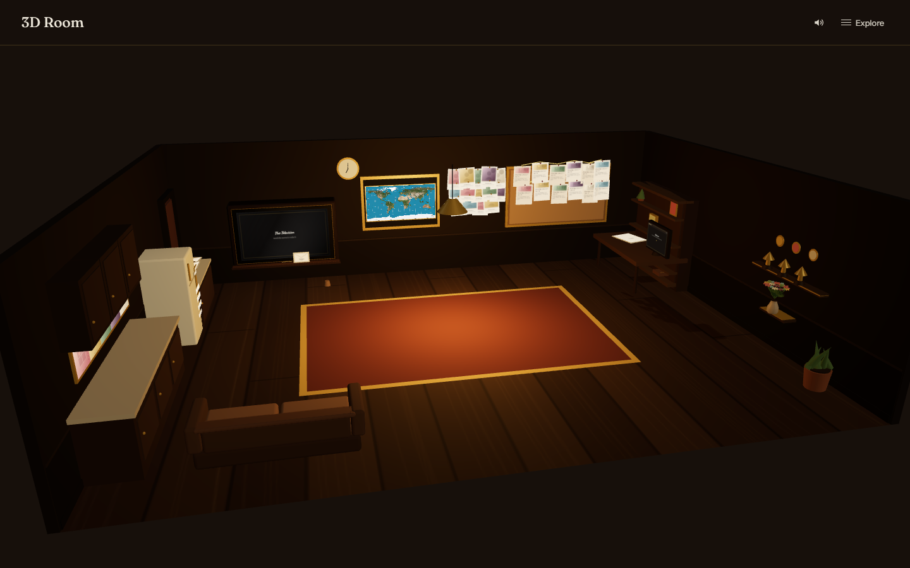
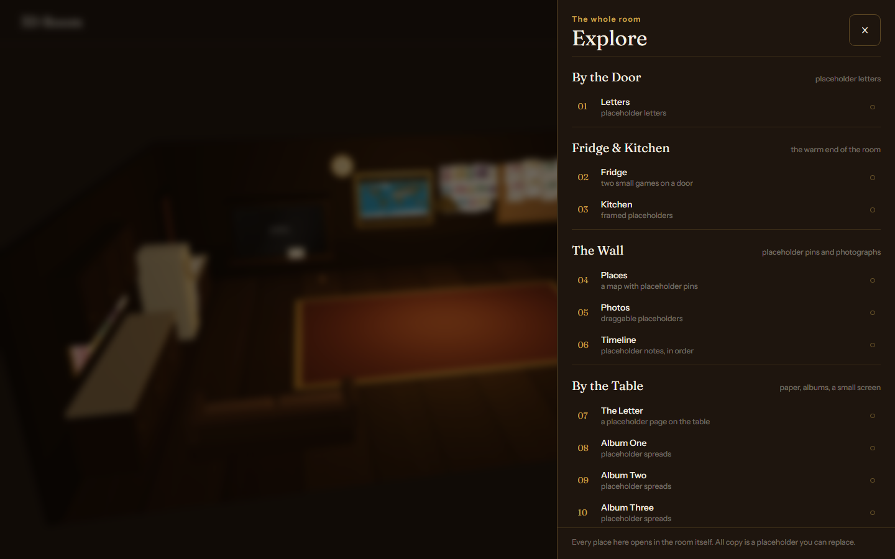
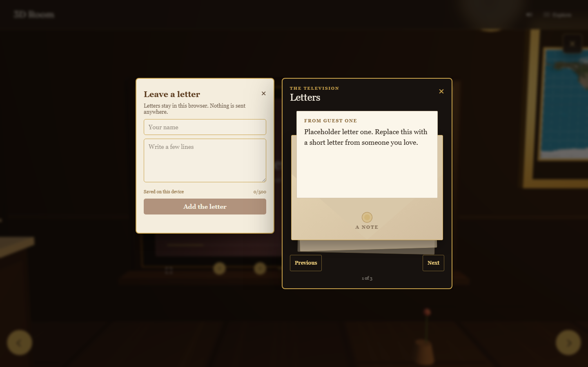
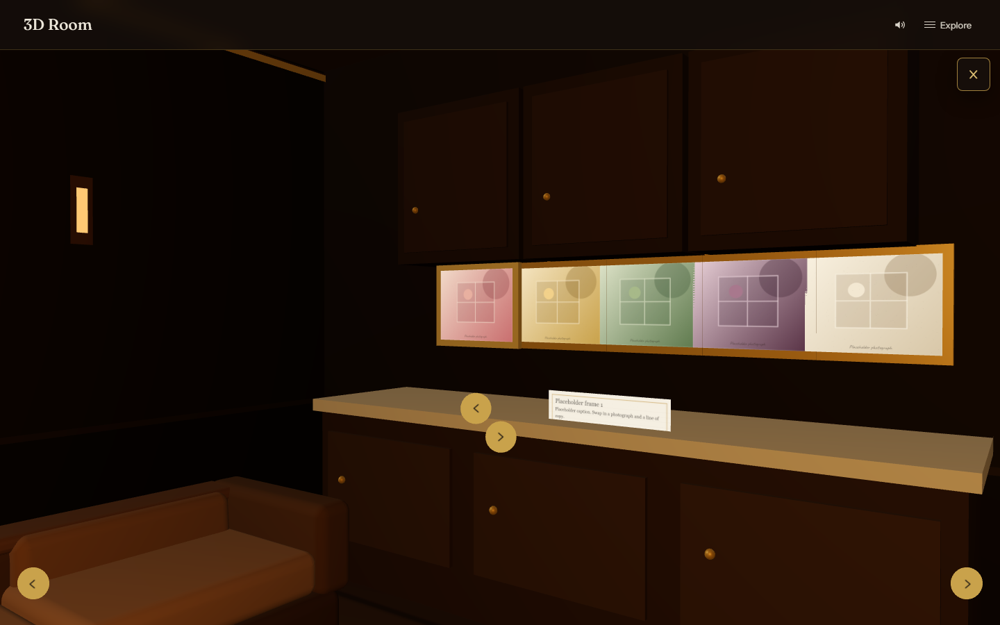
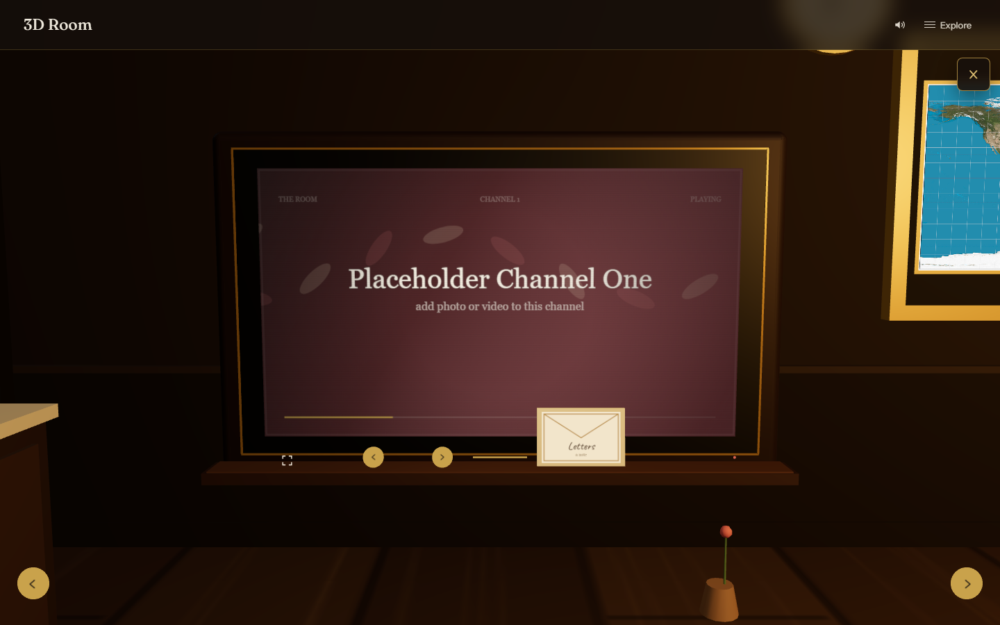
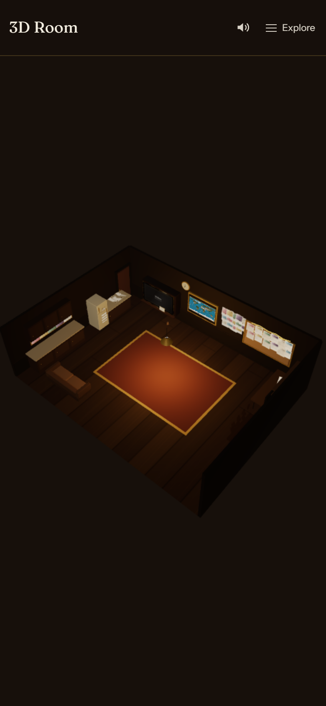

# 3D Room

A small, warm room built in real-time 3D — one page, sixteen places, and no pop-ups.
Every word and every photograph in this repository is a **placeholder**, so you can fork it and
make it yours without deleting anyone else's memories first.

[](https://hyperhrishi-hd.github.io/3d-room/)

The demo is built and published by the GitHub Pages workflow in
`.github/workflows/deploy-pages.yml`.



---

## What it is

One open-front room at golden hour. You move between places by clicking something in the room or
an entry in **Explore**. The camera flies to the object, the object floats out to be
read, and the content is painted into the room itself: letters on paper, albums that physically
open, a map with pins, a television that plays channels.

There is no dashboard, no feed and no scroll page. There is also **no backend**: it runs from a
static build, offline, with no keys. Letters written in the browser are kept in `localStorage`,
so they survive a reload without a database.

| Explore, kept in the room | Read a letter where it lives |
|---|---|
|  |  |

| The kitchen wall | The television |
|---|---|
|  |  |

On a phone the header folds down to two controls and the reading panels become bottom sheets:



---

## Quick start

```bash
git clone <your-fork-url> 3d-room
cd 3d-room
npm install
npm run dev
```

Open the address Vite prints. No environment variables are required.

```bash
npm run build      # type-check + production build into dist/
npm run preview    # serve the production build locally
```

Requires Node 20.19 or newer (Vite 7). The only runtime request to the outside world is the
Google Fonts stylesheet.

---

## What's inside the room

| Place | Where | What you can do |
|---|---|---|
| **Letters** | Hall counter, by the door | Read the envelopes, or write your own |
| **Fridge** | Kitchen wall | Play a memory-pair game and a three-option quiz |
| **Kitchen** | Kitchen wall | Open five framed placeholders and their captions |
| **Places** | Front wall | Tap map pins for a photograph and a note |
| **Photos** | Front wall | Drag the pinned prints around |
| **Timeline** | Front wall | Read twelve pinned moments in order |
| **The Letter** | Table | Float the page out and read it |
| **Albums** | Bookshelf | Open one book, four tabs, drag the then/now divider |
| **Notebook** | Bookshelf | Two tabbed sections of notes |
| **Monitor** | Table | Ask a question; answers are local until you connect an API |
| **Shelf** | Right wall | Five placeholder awards |
| **Flowers** | Floor below the shelf | Open a card on any bloom |
| **The TV** | Front wall | Five channels, cinema mode, the letters sheet, a progress bouquet |

Everything is data-driven from **one file**: `src/data/content.ts`.

---

## Make it yours

### 1. Change every word

Open `src/data/content.ts`. Each station reads its copy from there — letters, album pages,
timeline notes, quiz answers, awards, flower cards, TV channels. Nothing in `src/three/` needs to
change to rewrite the room.

### 2. Add real photographs

1. Drop a file into `public/media/`, for example `public/media/archive-01.jpg`.
2. Point an art spec at it:

```ts
{
  seed: 51,
  tone: 'rose',
  motif: 'portrait',
  label: 'A caption',
  src: '/media/archive-01.jpg',   // <- the placeholder is replaced by this print
}
```

Until `src` resolves, the designed placeholder stays in place — a missing file is never a blank
box. See `src/data/mediaManifest.ts` for optional preloading.

### 3. Letters stay in this browser

The letter card on the television opens a composer and a stack of envelopes. The three built-in
letters live in `src/data/content.ts` as `defaultLetters`. A letter you write is added by
`src/lib/letters.ts` to `localStorage` under `room-letters-v1`, appears on the hall counter and in
the sheet, and is still there after a reload. Nothing is sent anywhere and there is no database.

To share letters between visitors instead, replace `addLetter()` with a request to your own
endpoint. Keep moderation and rendering of public messages on the server. Clear the key from
DevTools to return the room to its three placeholders.

### 4. Change the places

`src/data/stations.ts` holds the sixteen entries, their sections and their camera volumes. Add or
remove an entry and the Explore menu, neighbour arrows, progress and URLs all follow. `context.md` explains each field.

### 5. Connect an AI model

The monitor is the only station that would call a model. It ships inert:

- `src/lib/api.ts` → `ROOM_AI_ENDPOINT` is empty, so answers come from `content.ts`;
- set it to your endpoint (or set `VITE_AI_ENDPOINT`) and the same screen starts using it;
- `server/ai-proxy.example.js` is a framework-neutral handler for the contract;
- `AI_API.md` documents the request, the response and the security rules.

The contract is deliberately tiny:

```http
POST /your-endpoint
Content-Type: application/json

{ "question": "What is this room?" }
```

```json
{ "answer": "A short reply from your model." }
```

Keep provider keys on the server. Never put them in a `VITE_` variable.

---

## How it works, in one screen

- **Renderer** — one `@react-three/fiber` canvas. Three visible walls, no ceiling, no orbit
  controls.
- **Camera** — a frame solver fits each station's 3D box into the safe area (viewport minus the
  header and close button) for the current aspect ratio, then a 1,100 ms flight lands on it.
- **Stations** — `focusBox` (closed), `readBox` (floated out), optional close-up. `FloatToRead`
  animates between them.
- **Text** — canvas textures from `textEngine.ts`; no HTML text inside the scene.
- **Pictures** — seeded procedural motifs in six tones, or a real file when `src` is set.
- **State** — `roomStore.tsx`: active, destination, travelling, menu, cinema, progress, canvas retry.
- **URLs** — `#/station/<id>`; `#/station/tv/letters` opens the letters over the television.
- **Failure** — if WebGL cannot start, a message and **Try the room again** appear; the retry
  remounts the canvas without a reload.

Deeper detail, including every coordinate and every preset: **[context.md](./context.md)**.

---

## Accessibility

Real buttons, visible focus, `Escape` to close, arrow-key traversal, focus trapping in the Explore
and letters sheets, a 48 px close control placed inside the safe area, pinch-zoom on reading
surfaces, and `prefers-reduced-motion` support.

---

## Deploy

The build is fully static. Run `npm run build` and publish `dist/` anywhere that serves files —
GitHub Pages, Netlify, Cloudflare Pages, an S3 bucket, a Raspberry Pi.

### GitHub Pages

The included workflow (`.github/workflows/deploy-pages.yml`) publishes the demo on every push to
`main`. It installs with `npm ci`, builds with the repository's subpath, adds `.nojekyll`, and uses
the official Pages actions.

1. Repository **Settings → Pages → Build and deployment → Source: GitHub Actions**.
2. Push to `main`, or run **Deploy the demo to GitHub Pages** from the Actions tab.

The workflow reads the base path from the repository name, so a fork deploys correctly without
edits. For a custom domain or a root deployment, set `BASE_PATH` to `/` (or your subpath) for the
build. Every public asset goes through `src/lib/assetUrl.ts`, which is why the same build works at
`/` locally and at `/<repo>/` on Pages.

Because the app uses hash routes, **no rewrite rules are needed**: every URL resolves to
`index.html`.

---

## What is not included

By design, this starter has no accounts, database, analytics, CMS, serverless functions, vendor
SDKs, pop-ups, tours or separate reading page. It is the room, the places, and placeholder content.
The one exception is `server/ai-proxy.example.js`: a copy-and-paste handler you add to your own
host if you want the monitor to talk to a model.

---

## Credits

- **Map** — NASA Earth Observatory Blue Marble, public domain (`public/media/LICENSE.md`).
- **Music** — "Chill lofi inspired (loop edit)" by omfgdude, loop edit by qubodup, CC0
  (`public/music/LICENSE.md`).
- **Interface sounds** — Kenney Interface Sounds and RPG Audio, CC0 (`public/sfx/LICENSE.md`).
- **Type** — Fraunces, Caveat and Instrument Sans, served by Google Fonts.

---

## License

MIT — see [LICENSE](./LICENSE). Use it, rewrite it, and put your own people in it.
